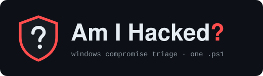
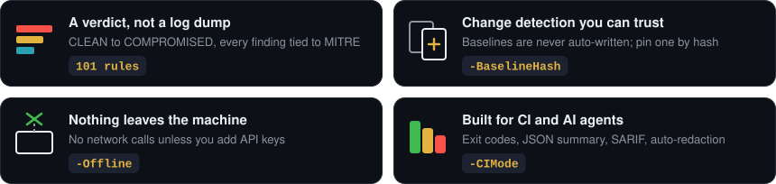
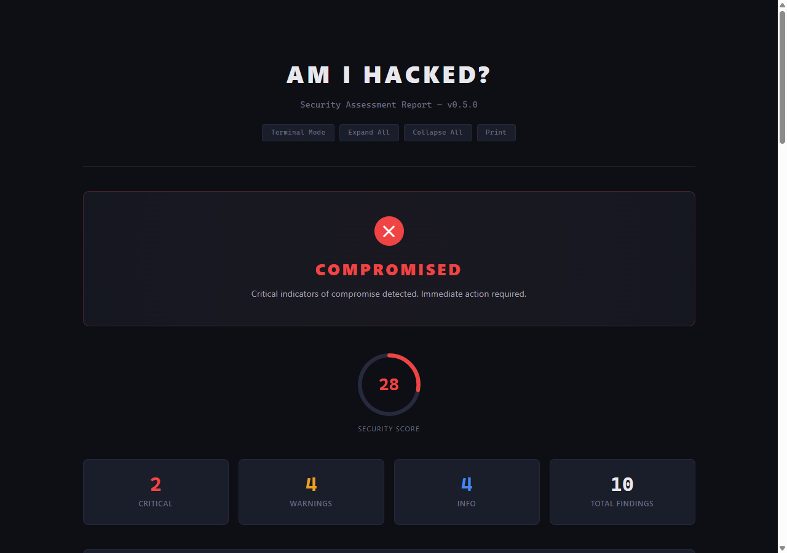
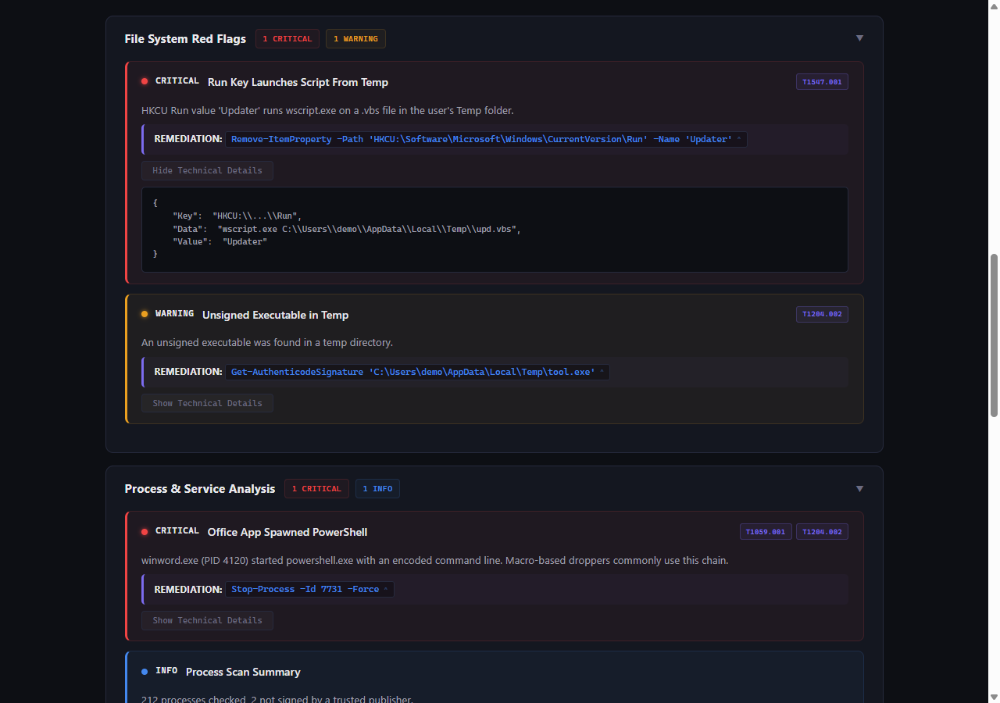
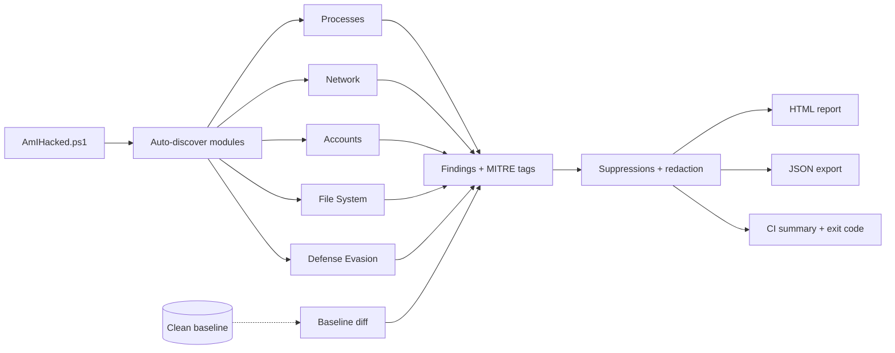

<div align="center">



<br>

[](https://github.com/TMHSDigital/Am-I-Hacked/actions/workflows/ci.yml)
[](https://github.com/TMHSDigital/Am-I-Hacked/releases)
[](docs/RULES.md)
[](#mitre-attck-coverage)


### Is this Windows machine compromised? One script, one verdict, a report you can act on.

Run it from an elevated PowerShell window. It checks processes, network, accounts, the file system and defenses,<br>
diffs everything against your own clean baseline, and tells you what to look at first.<br>
<sub>Built for people who look after their own PCs, help-desk and IT staff triaging a machine, and CI pipelines that need a gate.</sub>





[Quick start](#quick-start) &nbsp;·&nbsp; [Reading the results](#reading-the-results) &nbsp;·&nbsp; [Usage](#usage) &nbsp;·&nbsp; [Modules](#modules) &nbsp;·&nbsp; [Report](#report) &nbsp;·&nbsp; [Rule IDs](docs/RULES.md) &nbsp;·&nbsp; [FAQ](#faq--troubleshooting) &nbsp;·&nbsp; [Changelog](CHANGELOG.md)

</div>

> [!IMPORTANT]
> **Triage, not a guarantee.** A CLEAN verdict means none of the checks fired, not that the machine is clean: kernel rootkits and firmware implants can hide from anything running on the same system. If you have real reason to believe you're compromised, treat it as an incident. The tool only reads system state; it never deletes, quarantines or changes anything.

<details>
<summary><strong>Contents</strong></summary>

<br>

- [Quick start](#quick-start) · [Why](#why-this-exists) · [How it works](#how-it-works)
- [Reading the results](#reading-the-results): [Severity](#severity) · [Verdict](#verdict)
- [Usage](#usage) · [CI and AI agents](#ci--ai-agent-usage)
- [Modules](#modules) · [Report](#report) · [MITRE ATT&CK coverage](#mitre-attck-coverage)
- [Configuration](#configuration): [Suppressing false positives](#suppressing-false-positives)
- [Privacy](#privacy-what-leaves-your-machine) · [Requirements](#requirements) · [FAQ](#faq--troubleshooting)
- [Contributing](#contributing) · [Security](#security) · [Disclaimer](#disclaimer)

</details>

## Quick Start

```powershell
git clone https://github.com/TMHSDigital/Am-I-Hacked.git
cd Am-I-Hacked

# From an elevated (Run as Administrator) PowerShell window, for full results
.\AmIHacked.ps1
```

The report opens in your browser when the scan finishes, usually in under a minute. Findings are color-coded by severity, tagged with MITRE ATT&CK technique IDs, and include copy-paste remediation commands.

> [!TIP]
> **Script blocked?** Run it once with a process-scoped bypass: `powershell -ExecutionPolicy Bypass -File .\AmIHacked.ps1`. Details in the [FAQ](#faq--troubleshooting).

<details>
<summary><strong>First time? Create a baseline first.</strong></summary>

```powershell
# Step 1: on a system you trust, snapshot the current state
.\AmIHacked.ps1 -CreateBaseline
# Note the SHA-256 it prints and keep it somewhere safe

# Step 2: run scans any time later. Changes since the baseline are flagged.
.\AmIHacked.ps1 -BaselineHash <sha256-from-step-1>
```

Baselines enable **change detection**, the most useful signal for catching compromises. New ports, services, accounts, autorun entries, scheduled tasks (including changed task actions), and Defender exclusions are flagged against your snapshot.

> Baselines are only written when you pass `-CreateBaseline`. A scan of a compromised system never overwrites your clean baseline.
> Anything with write access to the `reports` folder could still edit it, so keep the SHA-256 printed by `-CreateBaseline` (or a copy of the baseline) on removable or remote storage and pass it back with `-BaselineHash`. Scans also report an INFO when the baseline file was modified after it was created.

</details>

---

## Why This Exists

Most security tools are either enterprise-grade (licences, agents, a cloud console) or one-liners that check three things. **Am I Hacked?** sits in between: one PowerShell script, 101 detection rules across 5 security domains, a diff against your own clean baseline, and a report that says what to do next. No installation, no dependencies, and no internet unless you add API keys.

| | Am I Hacked? | Ad-hoc one-liners | Enterprise EDR |
|---|---|---|---|
| Install | Clone and run | None | Agent rollout |
| Covers persistence, accounts, network, defenses | Yes, 101 rules | A few checks | Yes |
| Diffs against *your* clean state | Yes, hash-pinned baseline | No | Varies |
| Readable verdict and remediation | HTML report + exit codes | Raw output | Console |
| Data leaves the machine | Never by default | No | Yes |
| Cost | Free, MIT | Free | Per seat |

<p align="center">
  
  
  <br>
  <sub>Sample report generated from synthetic findings. No real system data.</sub>
</p>

### How It Works



---

## Reading the Results

### Severity

| Severity | Meaning | What to do |
|---|---|---|
| `CRITICAL` | Strong indicator of compromise or a disabled core defense | Act now. Read the finding, run the remediation, and consider the system untrusted until you understand it. |
| `WARNING` | Suspicious, or a weakened configuration | Investigate. Many warnings have innocent explanations; the description says what to check. |
| `INFO` | Context worth knowing | Review when convenient. INFO-only categories start collapsed in the report. |

### Verdict

| Verdict | Condition | CI exit code |
|---|---|---|
| **CLEAN** | No CRITICAL or WARNING findings | `0` |
| **CAUTION** | 1 to 3 WARNINGs, no CRITICAL | `1` |
| **SUSPICIOUS** | 4 or more WARNINGs, no CRITICAL | `1` |
| **COMPROMISED** | At least one CRITICAL | `2` |

The **security score** starts at 100 and subtracts 25 per CRITICAL, 5 per WARNING, and 0.5 per INFO, clamped to 0 to 100.

> [!WARNING]
> **CLEAN does not mean guaranteed clean.** This is a heuristic triage tool. If you have real reason to believe you're compromised, treat it as an incident: disconnect, preserve evidence, and get professional help.

<details>
<summary><strong>Got a CRITICAL? A short playbook.</strong></summary>

1. **Don't panic, and don't wipe yet.** Read the description and the Technical Details. They name the exact process, file, key, or account.
2. **Verify.** Is the file signed by a vendor you recognize? Did you install the software or create the task yourself? Look up the hash on VirusTotal.
3. **Contain.** If it's not yours, disconnect from the network before you clean up.
4. **Remediate.** The remediation command is a starting point. Click it to copy, and read it before you run it.
5. **Change passwords from a different, trusted device** if credential theft is possible (info-stealer artifacts, LSASS access, new accounts).
6. **Rescan** to confirm, then create a fresh baseline only once you're confident the system is clean.

If it's a false positive, add a [suppression](#suppressing-false-positives) and consider [reporting it](https://github.com/TMHSDigital/Am-I-Hacked/issues/new?template=false_positive.md) so the default rules improve.

</details>

---

## Usage

```powershell
# Offline mode: no API calls (VirusTotal, AbuseIPDB)
.\AmIHacked.ps1 -Offline

# Export JSON alongside HTML, and SARIF for CI tools
.\AmIHacked.ps1 -ExportJson -ExportSarif

# See which modules exist, then run only some of them
.\AmIHacked.ps1 -ListModules
.\AmIHacked.ps1 -Modules Network,Processes

# Skip specific modules
.\AmIHacked.ps1 -SkipModules Network,Accounts

# Compare against a specific baseline, verifying its hash
.\AmIHacked.ps1 -BaselinePath D:\clean_baseline.json -BaselineHash <sha256>

# Custom output directory
.\AmIHacked.ps1 -OutputPath "C:\SecurityReports"

# Mask operator identity in output (for screenshots / sharing)
.\AmIHacked.ps1 -Redact

# CI / AI agent mode (structured JSON summary + exit code)
.\AmIHacked.ps1 -CIMode -ExportJson -Offline
```

| Parameter | Description |
|-----------|-------------|
| `-OutputPath` | Report output directory (default: `.\reports`) |
| `-SkipModules` | Module names to skip (e.g. `Network,Accounts,Baseline`) |
| `-Modules` | Run only these modules, e.g. `-Modules Network,Processes` (Baseline still runs unless skipped) |
| `-ListModules` | List available module names and descriptions, then exit |
| `-ConfigPath` | Path to `config.json` (default: `.\config\config.json`) |
| `-Offline` | Disable all external API calls |
| `-BaselinePath` | Path to a specific baseline JSON |
| `-CreateBaseline` | Snapshot current system state (prints the baseline's SHA-256) |
| `-BaselineHash` | SHA-256 printed by `-CreateBaseline`; the baseline is ignored with a WARNING if it no longer matches |
| `-ExportJson` | Emit findings as JSON alongside HTML (each finding has a stable `RuleId` and `Key`) |
| `-ExportSarif` | Also write a SARIF 2.1.0 log for SARIF viewers and CI tools (rule IDs, severity levels, fingerprints) |
| `-VerboseOutput` | Enable verbose console output (same as `-Verbose`) |
| `-Redact` | Mask operator identity (computer name, username, paths) in all output |
| `-CIMode` | Agent/CI-friendly output: suppress banner + browser, auto-redact, JSON summary on stdout, structured exit code |

Unknown module names passed to `-Modules` or `-SkipModules` produce a warning listing the valid names.

---

## CI / AI Agent Usage

`-CIMode` makes the tool usable by CI pipelines and AI terminal agents (Claude Code, Cursor, etc.):

```powershell
.\AmIHacked.ps1 -CIMode -ExportJson -Offline
```

**What changes in CI mode:**

- ASCII banner is replaced with a single plain-text header
- Browser auto-open is suppressed
- `-Redact` is enabled automatically (operator identity masked)
- A machine-readable JSON summary is printed to stdout after all output:

```
---AMIHACKED-SUMMARY-JSON---
{"verdict":"CAUTION","critical":0,"warning":3,"info":12,"suppressed":0,"total":15,"duration":28.4,"reportPath":"...","version":"0.5.0"}
```

- Exit code reflects findings: **0** = clean, **1** = warnings only, **2** = critical findings detected

Sessions started with `powershell.exe -NonInteractive` (or `pwsh -NonInteractive`), and sessions without an interactive desktop such as services, auto-enable CI mode behaviors.

<details>
<summary><strong>Parsing the summary</strong></summary>

```powershell
$output = .\AmIHacked.ps1 -CIMode -ExportJson 2>&1
$summary = (($output -join "`n") -split "---AMIHACKED-SUMMARY-JSON---")[-1].Trim() | ConvertFrom-Json
if ($summary.critical -gt 0) { Write-Error "Critical findings: see $($summary.reportPath)" }
```

</details>

---

## Modules

<table>
<tr>
<td width="260"><strong>Process & Service Analysis</strong><br><code>Processes</code></td>
<td>Unsigned process detection (Authenticode-verified), suspicious parent→child chains (Word→PowerShell), temp directory executables, malicious service configs, unquoted service paths, known attack tools (Mimikatz, Cobalt Strike, etc.)</td>
</tr>
<tr>
<td><strong>Network Indicators</strong><br><code>Network</code></td>
<td>External connections with reverse-DNS, AbuseIPDB threat intel, unusual listening ports (including WinRM and SSH), DNS hijacking, hosts file tampering, proxy injection (WinINET, PAC files, WinHTTP), Windows Firewall status</td>
</tr>
<tr>
<td><strong>Account & Authentication</strong><br><code>Accounts</code></td>
<td>Recently created & hidden accounts ($ suffix), admin group audit, brute force detection (Event 4625), RDP session history, credential dumping artifacts (LSASS/SAM), LSA protection status</td>
</tr>
<tr>
<td><strong>File System Red Flags</strong><br><code>FileSystem</code></td>
<td>Modified system binaries, temp file scanning with signature verification, VirusTotal hash lookups, Alternate Data Streams, info-stealer artifacts, 8 persistence mechanisms (Run keys, IFEO, AppInit_DLLs, Winlogon, COM hijacking, WMI subscriptions, ghost scheduled tasks, BITS job abuse), Defender exclusion audit</td>
</tr>
<tr>
<td><strong>Defense Evasion</strong><br><code>DefenseEvasion</code></td>
<td>Cleared event logs, AMSI tampering, antivirus status (Defender or a registered third-party AV), Defender tamper protection, ETW autologger tampering, DisableAntiSpyware policy, PowerShell profile injection (Windows PowerShell and PowerShell 7, all users), root certificate store anomalies checked against Microsoft's trusted root list</td>
</tr>
<tr>
<td><strong>Baseline Comparison</strong><br><code>Baseline</code></td>
<td>New listening ports, services, accounts, Run keys, scheduled tasks (and changed task actions), and Defender exclusions since your clean snapshot, with optional SHA-256 integrity check</td>
</tr>
</table>

> **Extensible by design.** Drop a `Check-YourModule.ps1` into `modules/` and it's auto-discovered. No registration needed.

---

## Report

The HTML report is a single self-contained file. It loads nothing from the network (enforced by a Content-Security-Policy), so it's safe to open offline or attach to a ticket.

| Feature | Description |
|---------|-------------|
| **Security Score** | Animated SVG donut chart (0–100) based on finding severity |
| **Verdict Banner** | CLEAN / CAUTION / SUSPICIOUS / COMPROMISED |
| **Category Chart** | Stacked bar chart of findings per module |
| **MITRE ATT&CK Badges** | Clickable technique IDs linking to attack.mitre.org |
| **Filterable Findings** | Filter by severity, expand/collapse categories |
| **Copy-Paste Remediation** | Click any PowerShell command to copy to clipboard |
| **Technical Details** | JSON drill-down for every finding |
| **Rule ID & Key** | Stable [rule ID](docs/RULES.md) and item key under each finding, ready to paste into a suppression |
| **Dual Theme** | Professional default + "Terminal Mode" (CRT scanlines, glitch effects, neon glow) |
| **Auto-Collapse** | INFO-only categories start collapsed to surface what matters |
| **Print Support** | Clean print-optimized layout |

---

## Configuration

Copy the example config and edit it for your environment:

```powershell
Copy-Item config/config.example.json config/config.json
```

Then edit `config/config.json` (gitignored, so API keys stay local):

```jsonc
{
  "ProcessWhitelist": ["svchost", "csrss", ...],     // Skip known-good processes
  "TrustedCompanies": ["Microsoft Corporation", ...], // Vendor trust for signature checks
  "TrustedPorts": [135, 445, 5432, 8080, ...],       // Expected listening ports
  "TrustedIPs": ["13.107.0.0/16", ...],              // CIDR ranges to skip
  "TrustedDomainSuffixes": [".microsoft.com", ...],   // FP reduction for reverse-DNS
  "VirusTotalAPIKey": "",                              // Free: virustotal.com
  "AbuseIPDBKey": "",                                  // Free: abuseipdb.com
  "SuspiciousParentChild": [                           // Process chain detection rules
    { "Parent": "winword.exe", "Child": "powershell.exe" }
  ]
}
```

> Your `config.json` only needs the keys you want to change. Anything you leave out falls back to the built-in defaults, and without a `config.json` the tool runs entirely on defaults.

### Suppressing false positives

Every environment has a few findings that are expected. Each finding in the report shows its **rule ID** and **key** (the specific item). Silence one item, a whole rule, or match by title, and record why:

```jsonc
"Suppressions": [
  { "rule": "AIH-BASE-NEW-PORT", "key": "6463", "reason": "Discord RPC, expected on this machine" },
  { "rule": "AIH-PROC-UNQUOTED-SERVICE-PATH",    "reason": "Vendor bug, no write access to intermediate paths" },
  { "pattern": "Autorun Entry: OneDrive*",        "reason": "Title wildcards still work" }
]
```

Rule IDs are stable across releases, so suppressions keep working when a title's wording or numbers change. The full list is in [docs/RULES.md](docs/RULES.md).

Suppressed findings are dropped before they're printed or stored. The count still appears in the summary and in the CI JSON (`suppressed`), so nothing disappears silently.

<details>
<summary><strong>All configuration options</strong></summary>

| Key | Type | Description |
|-----|------|-------------|
| `ProcessWhitelist` | `string[]` | Process names to skip during signature checks |
| `ServiceWhitelist` | `string[]` | Service names to skip |
| `TrustedIPs` | `string[]` | IPs/CIDRs that won't be flagged |
| `TrustedPorts` | `int[]` | Expected listening ports (affects listener checks only) |
| `CommonRemotePorts` | `int[]` | Remote ports below 1024 that outbound connections may use without a "Connection on Uncommon Port" warning |
| `TrustedCompanies` | `string[]` | Vendor names for trust verification |
| `TrustedDomainSuffixes` | `string[]` | Domain suffixes for reverse-DNS FP reduction |
| `VirusTotalAPIKey` | `string` | VT API key for hash lookups |
| `AbuseIPDBKey` | `string` | AbuseIPDB key for IP reputation |
| `SuspiciousParentChild` | `object[]` | Parent→Child process rules |
| `SuspiciousTempExtensions` | `string[]` | Extensions flagged in temp directories |
| `TrustedAppDirs` | `string[]` | App directory names to skip during temp-dir scanning |
| `Suppressions` | `object[]` | Findings to silence permanently. Each entry sets `rule` (rule ID) and optionally `key`, and/or `pattern` (title); wildcards allowed; optional `reason` |
| `BackdoorPorts` | `int[]` | Ports that trigger CRITICAL instead of WARNING on listeners |
| `KnownDNSServers` | `string[]` | DNS servers considered legitimate (Google, Cloudflare, etc.) |
| `AbuseIPDBMaxChecks` | `int` | Max IPs to check against AbuseIPDB per scan (default: 30) |
| `MaxVTLookups` | `int` | Max file hashes to check against VirusTotal per scan (default: 4) |
| `AccountMaxAgeDays` | `int` | Flag accounts created within N days |
| `FileSystemMaxAgeDays` | `int` | Flag recently modified system executables |
| `MaxEventLogEntries` | `int` | Max events to scan per log |

</details>

> **Tip:** API keys are optional but recommended. VirusTotal catches malware by hash; AbuseIPDB catches known C2 IPs. Both have generous free tiers.

---

## Privacy: What Leaves Your Machine

Nothing, by default. Without API keys (or with `-Offline`) the scan makes no requests to third-party services.

| Data | Sent to | When |
|---|---|---|
| SHA-256 hashes of a few suspicious files (never the files) | VirusTotal | Only with a `VirusTotalAPIKey`, not in `-Offline`, capped by `MaxVTLookups` |
| Public IPs of external connections | AbuseIPDB | Only with an `AbuseIPDBKey`, not in `-Offline`, capped by `AbuseIPDBMaxChecks` |
| Reverse-DNS lookups of external connection IPs | Your configured DNS resolver | Always, the same as any normal name lookup |

Reports are written locally to `reports\` (gitignored). Use `-Redact` before sharing a report or screenshot: it masks your computer name, username, domain, and profile paths everywhere in the output.

---

## MITRE ATT&CK Coverage

Every finding is tagged with technique IDs from the [MITRE ATT&CK](https://attack.mitre.org/) framework.

<details>
<summary><strong>Full coverage matrix (46 techniques across 11 tactics)</strong></summary>

| Tactic | Techniques |
|--------|-----------|
| **Execution** | T1059.001, T1204.002 |
| **Initial Access** | T1078.003 |
| **Persistence** | T1053.005, T1078.003, T1098, T1136.001, T1197, T1543.003, T1546.003, T1546.010, T1546.012, T1546.013, T1546.015, T1547.001, T1547.004 |
| **Privilege Escalation** | T1078.003, T1574.001, T1574.009 |
| **Defense Evasion** | T1036.001, T1036.005, T1070.001, T1078.003, T1553.004, T1562.001, T1562.002, T1562.004, T1564, T1564.002, T1564.004 |
| **Credential Access** | T1003.001, T1003.002, T1003.003, T1110, T1110.001, T1555, T1555.003, T1557 |
| **Lateral Movement** | T1021.001, T1021.004, T1021.006 |
| **Collection** | T1005, T1560.001 |
| **Command & Control** | T1071.001, T1090, T1571 |
| **Impact** | T1565.001 |
| **Resource Development** | T1584.002, T1588.002 |

</details>

---

## Requirements

| Requirement | Details |
|-------------|---------|
| **OS** | Windows 10 / 11 |
| **PowerShell** | Windows PowerShell 5.1 (ships with Windows) or PowerShell 7+ |
| **Privileges** | Administrator recommended (required for the Security event log, Defender details, and some service checks). Non-admin scans still run and tell you what was skipped. |
| **Dependencies** | None. Zero. Nada. |
| **Internet** | Optional, only for VirusTotal/AbuseIPDB API calls |

---

## FAQ & Troubleshooting

<details>
<summary><strong>"Running scripts is disabled on this system" / "not digitally signed"</strong></summary>

Windows blocks unsigned scripts by default, and files downloaded as a ZIP are marked as coming from the internet. Either run it once with a process-scoped bypass (nothing is changed permanently):

```powershell
powershell -ExecutionPolicy Bypass -File .\AmIHacked.ps1
```

or unblock the downloaded files and allow local scripts for your user:

```powershell
Get-ChildItem -Recurse | Unblock-File
Set-ExecutionPolicy -Scope CurrentUser RemoteSigned
```

</details>

<details>
<summary><strong>I'm not running as Administrator. Is the scan still useful?</strong></summary>

Yes, but some checks can't see everything: the Security event log (brute force, RDP history, log clears), Defender details, and some service and account data. These show up as INFO findings such as "Event Log Access Denied" rather than being silently treated as clean. For a full picture, run from an elevated PowerShell window.

</details>

<details>
<summary><strong>A finding is a false positive</strong></summary>

Add a [suppression](#suppressing-false-positives) for your machine, and please [open a false-positive report](https://github.com/TMHSDigital/Am-I-Hacked/issues/new?template=false_positive.md) so the default rules get better for everyone. Use `-Redact` when you copy output into an issue.

</details>

<details>
<summary><strong>Does it remove malware?</strong></summary>

No. It only reads system state; the only files it writes are its own reports and baselines. Each finding comes with a suggested remediation command for you to review and run yourself.

</details>

<details>
<summary><strong>Can I schedule it?</strong></summary>

Yes. Run it from Task Scheduler with `-CIMode -ExportJson` and check the exit code (0 clean, 1 warnings, 2 critical). Non-interactive sessions enable CI behavior automatically, so no browser window opens.

</details>

---

## Contributing

Contributions welcome! See [CONTRIBUTING.md](CONTRIBUTING.md) for the full guide.

The module system is fully dynamic: add a `Check-YourModule.ps1` to `modules/` with an `Invoke-YourModuleChecks` function and it's auto-discovered.

Before opening a PR, run the same checks CI runs:

```powershell
.\tests\Invoke-StaticChecks.ps1 -Analyzer   # UTF-8 BOM, parse errors, PSScriptAnalyzer
.\tests\Invoke-MockScan.ps1                 # Unit tests + mock IOCs that must be detected
```

All `.ps1` files must be saved as UTF-8 **with BOM** (Windows PowerShell 5.1 needs it); `.\fix-bom.ps1` re-applies it if your editor strips it. Look for issues labeled [`good first issue`](https://github.com/TMHSDigital/Am-I-Hacked/labels/good%20first%20issue) to get started.

<details>
<summary><strong>Ideas for new modules & detections</strong></summary>

- Browser extension analysis
- DNS-over-HTTPS covert channel detection
- SSH key enumeration and audit
- Clipboard monitoring detection
- Named pipe analysis
- DLL search order hijacking (beyond COM)

</details>

<details>
<summary><strong>Project structure</strong></summary>

```
Am-I-Hacked/
├── AmIHacked.ps1                 # Entry point & orchestrator
├── config/
│   └── config.example.json       # Example config (copy to config.json)
├── modules/
│   ├── Check-Processes.ps1       # Process & service analysis
│   ├── Check-Network.ps1         # Network indicators
│   ├── Check-Accounts.ps1        # Account & authentication
│   ├── Check-FileSystem.ps1      # File system red flags
│   └── Check-DefenseEvasion.ps1  # Defense evasion detection
├── lib/
│   ├── Helpers.ps1               # Shared utilities, baseline, redaction, TUI
│   └── ReportGenerator.ps1       # Self-contained HTML report generator
├── docs/
│   └── RULES.md                  # Rule ID catalog (checked against the code by the harness)
├── tests/
│   ├── Invoke-MockScan.ps1       # Unit tests + mock IOC harness
│   └── Invoke-StaticChecks.ps1   # BOM, parse, and PSScriptAnalyzer checks
├── .github/workflows/ci.yml      # CI on Windows PowerShell 5.1 and PowerShell 7
├── fix-bom.ps1                   # Re-applies UTF-8 BOM to .ps1 files
└── reports/                      # Generated reports (gitignored)
```

</details>

---

## Security

Found a vulnerability in the tool itself? Please don't open a public issue. See [SECURITY.md](SECURITY.md) for how to report it privately.

## Disclaimer

This tool is for **defensive security assessment only**. It identifies potential indicators of compromise but is not a replacement for professional incident response or enterprise security tools. No tool can guarantee a system is 100% clean.

---

<div align="center">

**[Report Bug](https://github.com/TMHSDigital/Am-I-Hacked/issues/new?template=bug_report.md)** · **[Request Detection](https://github.com/TMHSDigital/Am-I-Hacked/issues/new?template=detection_request.md)** · **[False Positive](https://github.com/TMHSDigital/Am-I-Hacked/issues/new?template=false_positive.md)** · **[Contributing](CONTRIBUTING.md)**

MIT License — [TM Hospitality Strategies](https://github.com/TMHSDigital)

</div>
